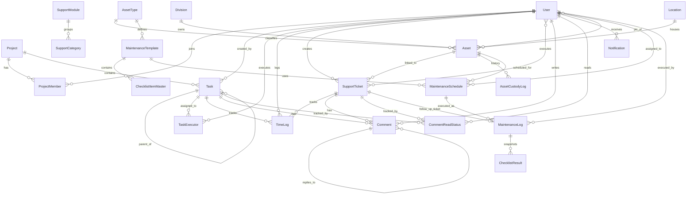

# Database Design & Migration Specification — IT Tracker v2

**Database Engine:** PostgreSQL 17 (`postgres:17-alpine`, container `ittracker-postgres`)  
**ORM:** Prisma  
**Object Storage:** MinIO (`ittracker-minio`) — seluruh file/gambar disimpan sebagai object key, bukan Base64 di PostgreSQL.

---

## 1. Entity Relationship Diagram (ERD)

---

## 2. Core Schema Design

### 2.1 Auth, Users & Permissions

#### `User`
| Column | Type | Constraints | Notes |
| :--- | :--- | :--- | :--- |
| `id` | `UUID` | PK | Dipertahankan dari v1 saat migrasi |
| `name` | `String` | NOT NULL | |
| `email` | `String` | UNIQUE, NOT NULL | |
| `password` | `String` | NOT NULL | bcrypt hash (dipertahankan dari v1) |
| `photo` | `String?` | Nullable | MinIO object key / URL |
| `jobDesk` | `String` | NOT NULL | |
| `role` | `UserRole` (Enum) | `ADMIN` \| `STAFF` | Normalisasi dari string v1 (`"Admin"`/`"Staff"`) |
| `telegramUsername` | `String?` | Nullable | Tanpa `@` |
| `telegramChatId` | `String?` | Nullable | Untuk pengiriman DM Telegram |
| `handledAreas` | `String[]` | Default `[]` | Nama area regional / lokasi untuk auto-assign |
| `canViewTeamLogs` | `Boolean` | Default `false` | Akses tab Team Logs untuk Staff |
| `canManageMaintenance` | `Boolean` | Default `false` | Menggantikan hardcode `"dwi"` di `auth.ts` |
| `preferredLocale` | `String` | Default `"en"` | `"en"` \| `"id"` |
| `preferredTheme` | `String` | Default `"light"` | `"light"` \| `"dark"` |
| `isActive` | `Boolean` | Default `true` | Soft-disable user tanpa merusak histori |
| `lastActiveAt` | `DateTime` | Default `now()` | Presence indicator |
| `createdAt` / `updatedAt` | `DateTime` | | |

---

### 2.2 Project Management & Hybrid Time Tracking

#### `Project`
| Column | Type | Notes |
| :--- | :--- | :--- |
| `id` | `UUID` (PK) | |
| `name` | `String` | |
| `description` | `String?` | |
| `objective` | `String?` | |
| `startDate` | `DateTime` | |
| `endDate` | `DateTime` | |
| `actualEndDate` | `DateTime?` | Otomatis terisi saat status menjadi `COMPLETED` |
| `status` | `ProjectStatus` | `NOT_STARTED` \| `ONGOING` \| `ON_HOLD` \| `COMPLETED` |
| `createdAt` / `updatedAt` | `DateTime` | |

#### `ProjectMember` *(Baru — menggantikan `Project.members` string koma)*
- `projectId` (FK → `Project`, Cascade)
- `userId` (FK → `User`, Cascade)
- `@@id([projectId, userId])`

#### `Task`
| Column | Type | Notes |
| :--- | :--- | :--- |
| `id` | `UUID` (PK) | |
| `parentId` | `UUID?` | FK self-relation (`TaskHierarchy`), `onDelete: Cascade` |
| `projectId` | `UUID?` | FK → `Project` (`onDelete: Cascade`) |
| `userId` | `UUID` | Creator FK → `User` |
| `sourceTicketId` | `UUID?` | FK opsional → `SupportTicket` (jika hasil *Promote to Task*) |
| `title` | `String` | |
| `startDate` | `DateTime` | |
| `endDate` | `DateTime` | Planned deadline |
| `startedAt` | `DateTime?` | Timestamp pertama kali masuk status `ONGOING` |
| `actualEndDate` | `DateTime?` | Timestamp selesai aktual |
| `priority` | `TaskPriority` | `LOW` \| `NORMAL` \| `HIGH` \| `URGENT` (migrasi `"Butuh Cepat"` → `URGENT`) |
| `status` | `TaskStatus` | `NOT_STARTED` \| `ONGOING` \| `COMPLETED` |
| `issue` | `String?` | Kendala |
| `solution` | `String?` | Solusi |
| `documentation` | `String?` | Link dokumen eksternal |
| `attachmentKey` | `String?` | MinIO object key |
| `sortOrder` | `Int` | Default `0`, stabil saat drag-and-drop |
| `createdAt` / `updatedAt` | `DateTime` | |

#### `TaskExecutor` *(Baru — menggantikan `Task.executor` string koma)*
- `taskId` (FK → `Task`, Cascade)
- `userId` (FK → `User`, Cascade)
- `@@id([taskId, userId])`

#### `TimeLog` *(Diaktifkan — Hybrid Auto + Editable)*
| Column | Type | Notes |
| :--- | :--- | :--- |
| `id` | `UUID` (PK) | |
| `taskId` | `UUID?` | FK → `Task` (Cascade) |
| `supportTicketId` | `UUID?` | FK → `SupportTicket` (Cascade) |
| `userId` | `UUID` | FK → `User` |
| `startTime` | `DateTime` | |
| `endTime` | `DateTime?` | `NULL` jika sesi masih berjalan |
| `durationSeconds` | `Int?` | Otomatis dihitung saat tutup sesi, dapat di-override manual |
| `source` | `TimeLogSource` | `AUTO` \| `MANUAL` \| `ADJUSTED` |
| `note` | `String?` | Alasan penyesuaian manual jika `ADJUSTED` |
| `createdAt` / `updatedAt` | `DateTime` | |

---

### 2.3 Support & Operational Logs (External-API Ready)

#### `SupportTicket`
| Column | Type | Notes |
| :--- | :--- | :--- |
| `id` | `UUID` (PK) | |
| `ticketNumber` | `String` (UNIQUE) | Auto-format `SUP-2026-0001` untuk kemudahan referensi manajemen & Telegram |
| `userId` | `UUID` | Creator FK → `User` |
| `ticketType` | `TicketType` | `REQUEST` \| `DAILY_ACTIVITY` |
| `taskName` | `String` | Judul tiket / aktivitas |
| `module` | `String` | Nama modul/sistem (dari Master `SupportModule`) |
| `supportType` | `String` | Kategori pekerjaan (dari Master `SupportCategory`) |
| `area` | `String?` | Regional area (khusus Master Data) |
| `priority` | `TicketPriority` | `LOW` \| `NORMAL` \| `HIGH` \| `URGENT` |
| `status` | `TicketStatus` | `NOT_STARTED` \| `ONGOING` \| `SUSPENDED` \| `DONE` |
| `startDate` | `DateTime` | Waktu tiket masuk / mulai aktivitas |
| `startedAt` | `DateTime?` | Waktu eksekusi dimulai (`ONGOING`) |
| `endDate` | `DateTime?` | Waktu selesai (null untuk `REQUEST` belum `DONE`) |
| `slaTargetMinutes` | `Int?` | Snapshot target SLA saat tiket `REQUEST` dibuat (dari `SlaPolicy`) |
| `slaDueAt` | `DateTime?` | `startDate + slaTargetMinutes` |
| `issue` | `String?` | Rich text / markdown |
| `solution` | `String?` | Rich text / markdown |
| `attachmentKey` | `String?` | MinIO object key |
| `link` | `String?` | Link eksternal |
| `requesterName` | `String?` | Nama pelapor |
| `requesterEmail` | `String?` | Email pelapor (siap untuk *Report Problem* eksternal) |
| `sourceType` | `TicketSource` | `MANUAL` \| `EXTERNAL_APP` \| `QR_SCAN` \| `MAINTENANCE` |
| `sourceApp` | `String?` | Nama sistem asal (misal `Sistem AI`, `HRIS`, `Factory`) |
| `sourceMenu` | `String?` | Nama menu/halaman asal kendala |
| `sourceUrl` | `String?` | URL halaman asal |
| `sourceMetadata` | `Json?` | Payload tambahan (browser, error code, user ID eksternal) |
| `assetId` | `UUID?` | FK opsional → `Asset` |
| `executors` | Relation M:N | `_SupportExecutors` ke `User` |
| `createdAt` / `updatedAt` | `DateTime` | |

---

### 2.4 Enterprise Asset Management, QR & Maintenance

#### `Division`
- `id` (UUID PK), `name` (UNIQUE), `code` (`String?`), `createdAt`, `updatedAt`.

#### `Location` *(Baru — menggantikan konstanta hardcode `AVAILABLE_LOCATIONS`)*
- `id` (UUID PK), `name` (UNIQUE — seed: `HO Jakarta`, `HO Makassar`, `Pabrik`, `Marketing`), `code` (`JKT`, `MKS`, `PBR`, `MKT`), `address` (`String?`), `createdAt`, `updatedAt`.

#### `AssetType`
- `id` (UUID PK), `name` (UNIQUE), `code` (`String?` misal `SRV`, `LPT`, `RTR`, `UPS`), `createdAt`, `updatedAt`.

#### `Asset`
| Column | Type | Notes |
| :--- | :--- | :--- |
| `id` | `UUID` (PK) | |
| `assetCode` | `String` (UNIQUE) | Dipakai untuk URL QR `/assets/q/[assetCode]` |
| `assetName` | `String` | |
| `assetTypeId` | `UUID` | FK → `AssetType` |
| `divisionId` | `UUID?` | FK → `Division` |
| `locationId` | `UUID?` | FK → `Location` |
| `detailedLocation` | `String?` | Lantai / Ruangan / Rak |
| `brand` / `model` / `serialNumber` | `String?` | |
| `specs` | `Json?` | Fleksibel (`cpu`, `ram`, `storage`, `ipAddress`, `macAddress`, `os`) |
| `assignedPerson` | `String?` | Pemegang/pengguna aset saat ini |
| `picUserId` | `UUID?` | PIC IT FK → `User` |
| `status` | `AssetStatus` | `ACTIVE` \| `IN_REPAIR` \| `SPARE` \| `INACTIVE` \| `RETIRED` \| `LOST` |
| `purchaseDate` | `DateTime?` | |
| `purchasePrice` | `Decimal(15,2)?` | Opsional untuk nilai inventaris |
| `vendor` | `String?` | |
| `warrantyEndDate` | `DateTime?` | |
| `photoKey` | `String?` | MinIO object key |
| `qrPrintedAt` | `DateTime?` | Tracking stiker QR sudah pernah dicetak atau belum |
| `notes` | `String?` | |
| `createdAt` / `updatedAt` | `DateTime` | |

#### `AssetCustodyLog` *(Baru — Histori Serah Terima Aset)*
- `id` (UUID PK), `assetId` (FK → `Asset`, Cascade), `previousPerson`, `newPerson`, `previousLocation`, `newLocation`, `previousDivision`, `newDivision`, `changedById` (FK → `User`), `note`, `changedAt` (`DateTime`).

#### `MaintenanceTemplate` & `ChecklistItemMaster`
- `MaintenanceTemplate`: `id`, `templateName`, `assetTypeId` (FK), `defaultFrequencyDays`, `reminderOffsetDays`, `createdAt`, `updatedAt`.
- `ChecklistItemMaster`: `id`, `templateId` (FK, Cascade), `itemText`, `order`, `isRequired`, `createdAt`, `updatedAt`.

#### `MaintenanceSchedule`
- `id`, `scheduleType` (`RECURRING` | `ADHOC`), `assetId` (FK), `templateId` (FK opsional), `frequencyDays`, `nextDueDate`, `status` (`UPCOMING` | `DUE` | `OVERDUE` | `DONE`), `lastRemindedAt` (`DateTime?` — mencegah double-spam cron!), `assignedExecutors` (M:N `User`), `createdAt`, `updatedAt`.

#### `MaintenanceLog` & `ChecklistResult`
- `MaintenanceLog`:
  - `id`, `scheduleId` (FK), `executedById` (FK → `User`), `executionDate`, `overallCondition` (`BAIK` | `PERLU_PERHATIAN` | `BERMASALAH`), `findings`, `followUpNeeded`, `supportTicketId` (**Foreign Key nyata** → `SupportTicket`, UNIQUE opsional), `attachmentKey` (MinIO object key), `createdAt`.
- `ChecklistResult`:
  - `id`, `logId` (FK, Cascade), `itemText` (snapshot permanen), `checked`, `note`.

---

### 2.5 Master Data, Collaboration & Governance Tables

- **`Comment`** & **`CommentReadStatus`**: Struktur dipertahankan dari v1 (`taskId`, `supportTicketId`, `replyToId`, `attachmentKey`).
- **`Notification`**: `id`, `userId`, `title`, `message`, `type` (`ASSIGNMENT` | `DEADLINE` | `SLA_BREACH` | `MAINTENANCE` | `SYSTEM`), `isRead`, `link` (seluruh link valid ke route nyata, e.g. `/maintenance?scheduleId=<id>`), `createdAt`.
- **`SupportModule`** (`id`, `groupName`, `name`, `isActive`, `sortOrder`) & **`SupportCategory`** (`id`, `moduleId`, `name`, `requiresArea`).
- **`RegionalArea`** (`id`, `name`, `isActive`).
- **`SlaPolicy`** (`priority` UNIQUE, `targetMinutes`, `reminderThresholdPercent`).
- **`ExternalApiKey`** (`id`, `name`, `sourceApp`, `keyHash`, `isActive`, `lastUsedAt`, `createdAt`) — siap untuk integrasi tombol *"Report Problem"*.
- **`AuditLog`** (`id`, `actorId`, `entityType`, `entityId`, `action`, `diffJson`, `createdAt`) — mencatat perubahan penting (status, delete, handover aset, koreksi TimeLog).

---

## 3. Indexing Strategy

Indeks kunci yang wajib ada untuk menjaga query Dashboard KPI, SLA Cron, dan Scan QR tetap cepat (`< 20ms`):
- `Task`: `@@index([projectId, status])`, `@@index([parentId])`, `@@index([endDate, status])`
- `SupportTicket`: `@@index([ticketType, status, startDate])`, `@@index([slaDueAt, status])`, `@@index([assetId])`, `@@index([createdAt])`
- `TimeLog`: `@@index([taskId, endTime])`, `@@index([supportTicketId, endTime])`, `@@index([userId, startTime])`
- `Asset`: `@@unique([assetCode])`, `@@index([divisionId, locationId, status])`, `@@index([warrantyEndDate])`
- `MaintenanceSchedule`: `@@index([status, nextDueDate])`, `@@index([assetId])`
- `Notification`: `@@index([userId, isRead, createdAt])`

---

## 4. 1:1 Data Migration Plan (v1 Production → v2 Schema)

Seluruh data produksi (sudah terverifikasi 1:1 di local dump `production.dump`) dimigrasikan melalui skrip idempoten `scripts/migrate-v1-to-v2.ts` dengan langkah:

1. **Seed Master Data Awal:**
   - Insert 4 `Location` (`HO Jakarta`, `HO Makassar`, `Pabrik`, `Marketing`), 16 `SupportModule` + `SupportCategory` dari `CATEGORY_MAP` lama, 27 `RegionalArea`, dan 4 default `SlaPolicy` (`URGENT=120m`, `HIGH=240m`, `NORMAL=1440m`, `LOW=2880m`).
2. **Migrasi `User` (9 rows):**
   - Pertahankan `id`, `email`, `password` (bcrypt hash tidak berubah), `telegramUsername`, `telegramChatId`, `handledAreas`, `canViewTeamLogs`.
   - Map `role`: `"Admin"` → `ADMIN`, lainnya → `STAFF`.
   - Set `canManageMaintenance = true` untuk `ADMIN` dan user dengan `name` mengandung `"dwi"` (`Dwi Ramdhan`).
3. **Migrasi `Project` (6 rows) & `ProjectMember`:**
   - Parse string koma `Project.members` → cocokkan dengan `User.name` → insert ke `ProjectMember`.
   - Map status string ke enum `ProjectStatus`.
4. **Migrasi `Task` (140 rows) & `TaskExecutor`:**
   - Pertahankan `id` & `parentId` (insert root tasks dulu, lalu subtasks agar FK `parentId` aman).
   - Parse `Task.executor` (string koma) → insert ke `TaskExecutor`.
   - Map `priority`: `"Butuh Cepat"` → `URGENT`, `"Normal"` → `NORMAL`.
   - Jika `status == COMPLETED` dan `actualEndDate` null, fallback `actualEndDate = updatedAt` (atau `endDate` bila relevan) agar KPI historis tetap konsisten.
5. **Migrasi `SupportTicket` (262 rows) + `_SupportExecutors` (204 links):**
   - Generate `ticketNumber` urut berdasarkan `createdAt` (`SUP-2026-0001` dst.).
   - Set `sourceType = MANUAL`.
   - **Ekstraksi Base64 → MinIO:** Untuk setiap record yang memiliki `attachment` diawali `data:...;base64,`, decode biner, upload ke bucket `ittracker-files` di `ittracker-minio` (`attachments/tickets/<id>.<ext>`), dan simpan key-nya di `attachmentKey`.
   - Hitung `slaTargetMinutes` & `slaDueAt` historis untuk tiket `REQUEST`.
6. **Migrasi `Division` (9), `AssetType` (18), `Asset` (17), `MaintenanceTemplate` (18), `ChecklistItemMaster` (82), `MaintenanceSchedule` (2), `_ScheduleExecutors` (1):**
   - Map string `Asset.location` lama ke `Location.id` (`locationId`) dan salin `Asset.person` → `Asset.assignedPerson`.
   - Buat 1 baris awal `AssetCustodyLog` untuk setiap aset yang sudah memiliki `assignedPerson`.
7. **Migrasi `Notification` (152) & `CommentReadStatus` (5):**
   - Pertahankan seluruh histori; perbaiki otomatis link lama `/maintenance/schedules/<id>` → `/maintenance?scheduleId=<id>`.
8. **Verifikasi Otomatis Post-Migration:**
   - Bandingkan total row count tiap tabel (v1 vs v2) dan pastikan 0 record hilang sebelum cutover.
